# Skill flows

What each skill does when you call it: what it reads, what it decides, where
it stops, and what it hands back. The diagrams are drawn from each
`skills/<name>/SKILL.md`. When a diagram and a skill disagree, the skill is
right and the diagram is the bug.

## How to read the diagrams

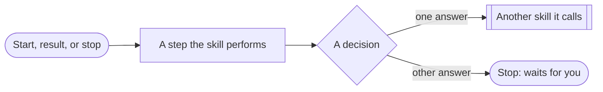

A result that begins with `Stop:` ends the run. The skill reports and does
nothing further until you answer.

## How the skills connect

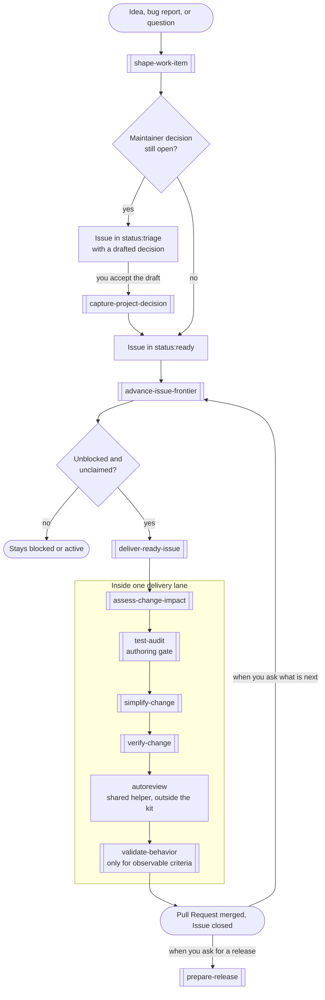

Six skills stand apart from the Issue flow and run when you call them:
`improve-performance`, `ci-audit`, `ui-e2e`, `api-e2e`,
`technical-documentation`, and `refactor-docs` (which loads
`technical-documentation` first).

## shape-work-item

Call it with a raw idea, bug report, refactoring proposal, or research
question. It returns a draft Issue and never publishes without authorization.

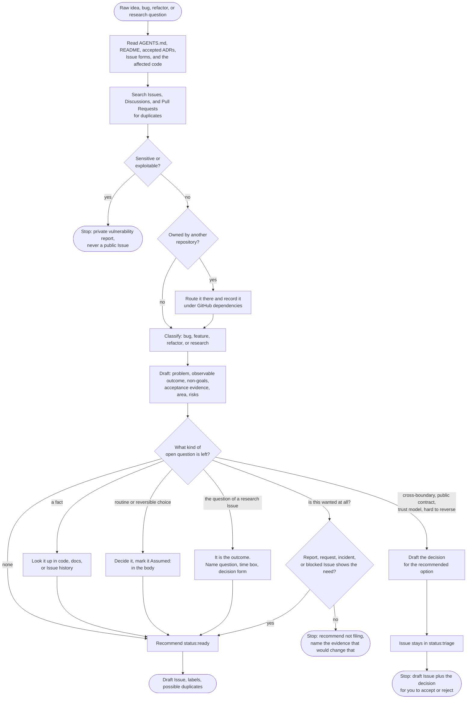

## advance-issue-frontier

Call it to ask what is ready next, or after a merge. It reports only, unless
you explicitly ask it to update Issue state.

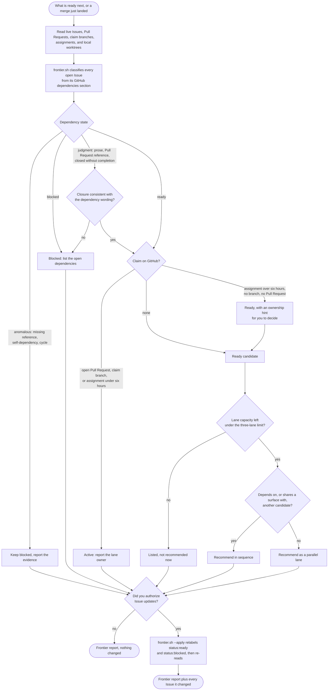

It never claims a lane, starts a branch, assigns anyone, or picks priority.

## deliver-ready-issue

Call it with one ready Issue. How far it goes depends on what you asked for:
**Implement** (local change, verified), **Publish** (plus commit, push, ready
Pull Request), or **Land** (plus merge and cleanup). When your request is
unclear it takes the lower ceiling.

### Before any code

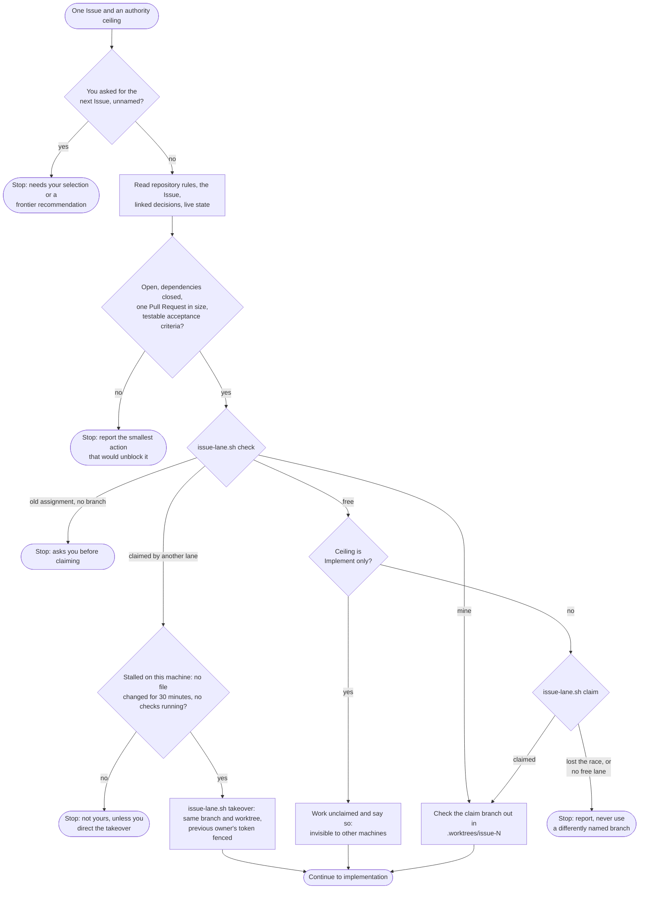

### Implement and verify

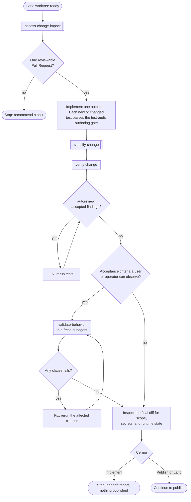

### Publish and land

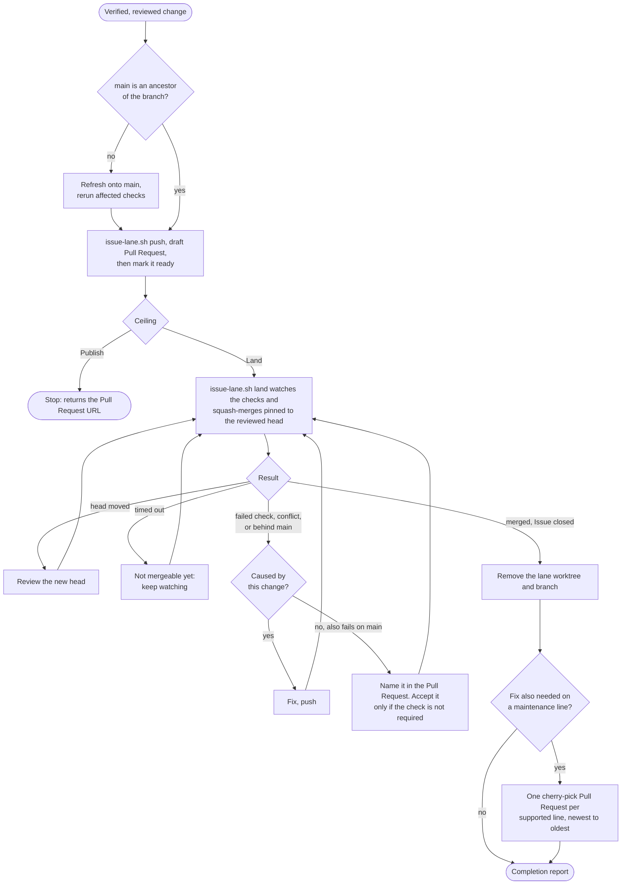

It never reruns CI to chase green, never queues auto-merge, and never picks
the next Issue on its own.

## assess-change-impact

Call it before implementing or reviewing a change whose reach is unclear.
`deliver-ready-issue` runs it first in every lane. It has no branches: it
walks five questions and returns a matrix.

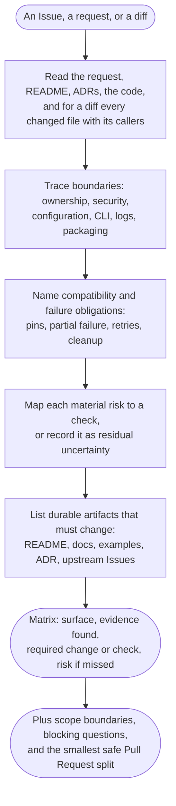

It does not approve an architecture or perform a security audit.

## test-audit

Two entry points: the authoring gate for a new or changed test, and an audit
that prunes existing ones. A static or slow test is not disposable for that
reason alone.

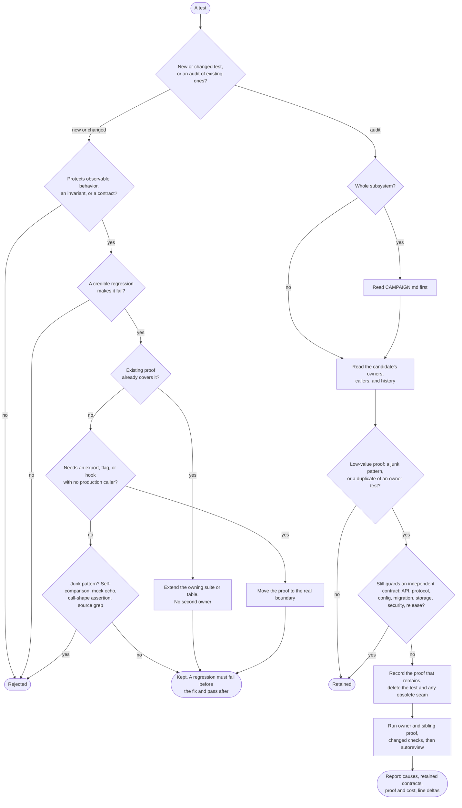

## simplify-change

Call it on your own finished diff, before review. `deliver-ready-issue` runs
it on every lane.

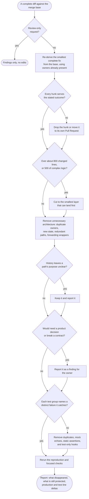

No change is a valid result when the existing shape is justified.

## verify-change

Call it to get exact evidence that a change works. It runs deterministic
checks only and does not replace autoreview.

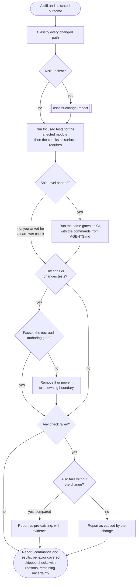

Skipped service or kernel tests are named with their reason and residual risk.

## validate-behavior

Call it in a fresh agent that has not seen the implementation. It judges the
running product against a contract, never the code.

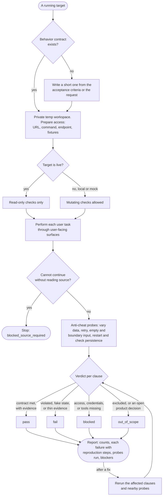

## capture-project-decision

Call it after a Discussion, Issue, or Pull Request has settled a choice.

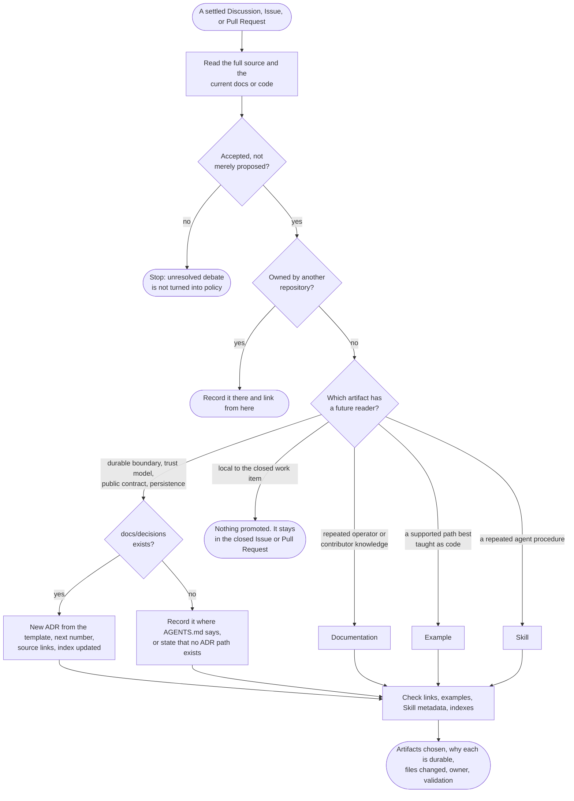

A superseded ADR gets a new ADR and a cross-link. The old text stays.

## prepare-release

Call it for release readiness, a version bump, or a release. The ceiling is
**Prepare** (audit and go/no-go), **Publish** (plus the version-bump Pull
Request), or **Release** (plus landing it and verifying the published
release). The agent never creates, signs, pushes, moves, or deletes a tag.

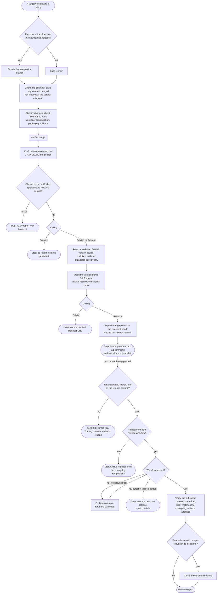

## improve-performance

Call it for measured performance work. A cache is the last step, not the
first.

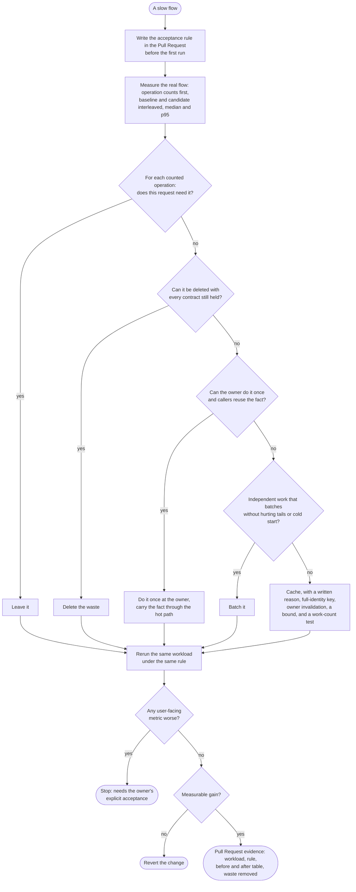

## ci-audit

Two entry points: the admission gate for a new job or a wider trigger, and an
audit of the jobs a repository already runs. Zero failures alone never
condemns a job.

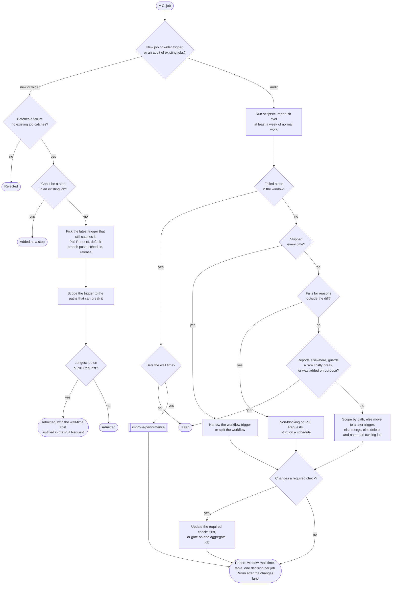

## ui-e2e

Call it for UI work. It picks stages by the kind of change, and the direction
stage always stops for your pick.

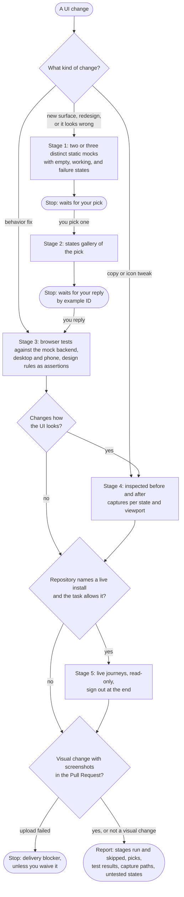

## api-e2e

Call it for a change to an interface the repository serves. It picks stages
by what the change touches, and a breaking change without a new version stops
for your decision.

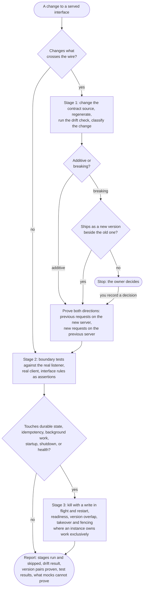

## technical-documentation

Call it to build or review documentation, including `AGENTS.md` and
`CONTRIBUTING.md`.

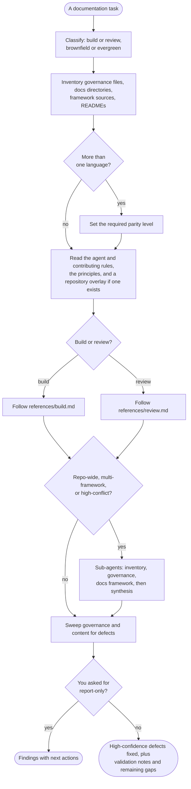

## refactor-docs

Call it with one target page to rewrite, split, or shorten. A rewrite never
discards a behavior fact silently.

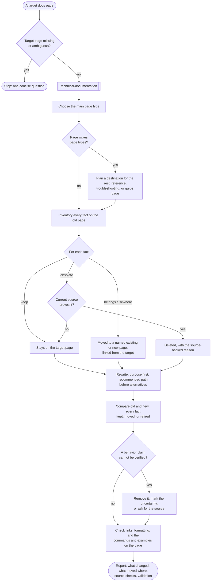
